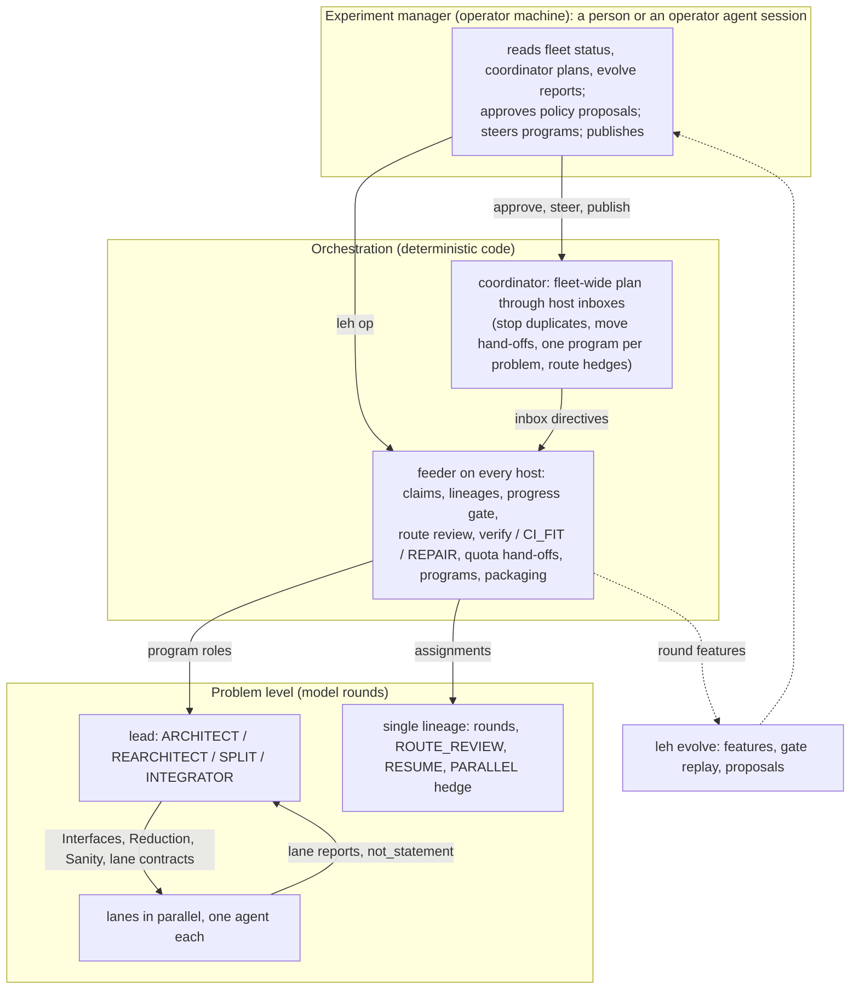
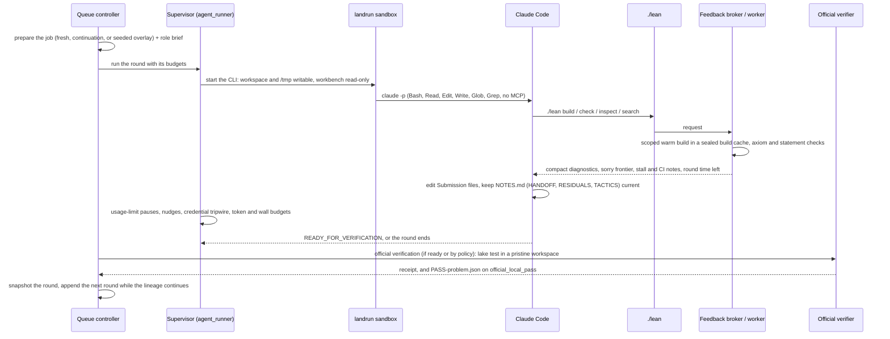

# Architecture

The harness turns subscription accounts and Linux hosts into a proving pipeline for Lean 4 problems whose
only acceptance is the official verification: a pristine pinned workspace, the toolchain's `lake comparator`
inside bubblewrap, the Lean kernel and NanoDa. This page describes the parts, how a problem moves through
them, and where state lives. [CONFIGURATION.md](CONFIGURATION.md) lists every setting, and
[OPERATIONS.md](OPERATIONS.md) the commands.

## Three levels of control



1. **Experiment manager.** The level that watches the whole experiment: which problems are worth the
   fleet, whether lineages converge, what the logs say about the harness itself. It approves or rejects
   the proposals of `leh evolve`, steers programs by hand when the feeder's rules are not enough
   (split a stuck lane, start a hedge on another route, re-architect), and publishes verified packages.
   In our campaign this was an operator with an agent session that followed
   [EXPERIMENT_MANAGER.md](EXPERIMENT_MANAGER.md). Nothing at this level runs automatically.
2. **Orchestration.** Deterministic code with no model in it. The **feeder** on each host decides every
   few minutes, from what the rounds left on disk, whether a lineage continues, stops, gets a route review,
   goes to verification, becomes a lane program, or hands off to another account. The **coordinator** on
   the operator machine reads every host and writes directives into their inboxes. The rules are in
   [fleet/docs/FEEDER-POLICY.md](../fleet/docs/FEEDER-POLICY.md) and
   [fleet/docs/COORDINATOR-POLICY.md](../fleet/docs/COORDINATOR-POLICY.md). The levers against tunnel
   vision live here: the progress gate measures movement of the RESIDUALS table, a stalled lineage gets a
   route review that sees the measured history and must switch tactic, and hedges must take a different
   route.
3. **Problem level.** Model rounds. A simple problem is one lineage of rounds. A large one becomes a
   program: a lead round writes the interfaces, the reduction and the sanity checks and hands out lanes
   with a contract (statement, consumer, sanity instance, estimate, source step, strength argument,
   reuse found in the bank); lanes run in parallel, each confined to its directory; a lane that refutes
   its statement sends the program back to the lead; an integrator round closes the holes.

## One round



- **Queue controller** (`fleet/server/controller.py`): one per runner (queue root). It reads
  `manifest.json`, runs each assignment once, adopts a still-running supervisor after a restart, runs the
  official verification and appends continuation rounds (`auto_continue`).
- **Runtime** (`runtime/leaneval`): `jobs` prepares a job from the pinned benchmark checkout;
  `agent_runner` supervises the pinned Claude Code binary inside landrun; `worker`, `feedback_broker`,
  `compact`, `compile_policy` and `build_cache` implement `./lean`; `research`, `frontier` and `lineage`
  hold the in-session gates; `finalization`, `verifier` and `artifacts` run the official verification and
  keep receipts; `continuation` snapshots a round and seeds the next; `quota` and `claude_accounting` track
  usage and limits; `secret_refs` resolves the account reference. `runtime-manifest.json` lists the file
  hashes the controller checks before it imports the runtime. [runtime/README.md](../runtime/README.md)
  describes the `./lean` contract in detail.
- **Verification is the only acceptance.** The verifier copies exactly `Submission.lean` and
  `Submission/**/*.lean` into a pristine workspace of the pinned benchmark, checks the dependency pins,
  runs the benchmark's sandbox probe and then `lake test`, whose `WorkspaceTest` runs the toolchain's
  `lake comparator` (leanexport, the Lean checker and the toolchain's `nanoda_bin`) in bubblewrap. A pass
  needs exit 0, both kernels' acceptance lines and unchanged inputs; the receipt goes into a registry the
  agent cannot write. A model reply, NOTES.md or a gate decision never counts.

## Lineages, programs, the fleet

- **Lineage.** Rounds of one attempt. After every round the feeder measures what the workspace holds
  (sorry count, RESIDUALS rows and their summed estimate, the last whole build) and decides: continue,
  stop as stalled, route review, hand off for quota, verify, CI fit, repair, or a lane program. A round
  that is complete (no `sorry`, `./lean build Submission` passed on exactly these files) is never a stall:
  it goes to a VERIFY lineage; a timeout leads to CI_FIT with the measured module times, a rejection to
  REPAIR with the official log.
- **Program.** `programs/<problem>.json` on the host. The architect round writes
  `Submission/Lanes/{Interfaces,Reduction,Sanity}.lean` and lane stubs; `validate_architecture` refuses a
  split whose reduction does not compile, whose lanes lack the contract or a sanity theorem, or that
  leaves a `sorry` outside the stubs. Lanes run as ordinary lineages confined to their directory. A
  lane round starts from the architecture plus every finished lane, so finished tools are importable. Lanes
  are assigned in the order their statements appear in `Interfaces.lean`, so tool lanes come first. A lane that
  proves an interface statement false is stopped and is not counted as done, even if it has no `sorry`. Lanes
  record interface changes they need in `## INTERFACE REQUESTS`. A failed or refuting lane sends the program back
  to the architect (REARCHITECT, at most twice), with the refutations and the requests in the brief. An operator
  may split a lane (SPLIT) when the children are strictly weaker. The integrator merges.
- **Fleet.** Every runner host has its own feeder and queues. The coordinator gathers every host
  read-only and writes directives: stop a problem that passed elsewhere, move a quota hand-off to another
  host, keep one program per problem, start a parallel lineage on a different route.
- **Package and publish.** The feeder turns each pass into a package in `outbox/`: the verified proof
  files, the benchmark's `lakefile.toml` and `lean-toolchain`, README, PROVENANCE, VERIFICATION, licences,
  and a CI-fit estimate for the organizers' runner. `fleet/local/publish.py` pushes one branch per problem
  to the configured private repository (orphan commit, or a fast-forward only with a strictly better
  package; never a force push). `fleet/local/verify_current.py` re-verifies published branches on the
  current benchmark commit with `verify/` and commits the new record.
- **Evolve.** `leh evolve extract` reads every queue of a host (read-only) and sends back only round features
  and per-lane estimates and line counts. `leh evolve report` aggregates them, replays the progress gate at
  other thresholds, calibrates lane estimates and lists proposals for the experiment manager
  ([EVOLVE.md](EVOLVE.md)).
- **Map.** `leh map build` builds a program's merged tree and reports from Lean what is left, dead code,
  duplicated lemmas and refutations the proof relies on ([METHOD.md](METHOD.md) §9).

## State on a runner host

Defaults are relative to the home of the fleet user; each can be moved with the variable named
([CONFIGURATION.md](CONFIGURATION.md)).

```
~/leh-fleet/                      LEH_OWN_ROOT: feeder.py and tools, config.json, targets.json, claims.json,
                                  status.json, briefs/, programs/, inbox/, seeds/, outbox/, runtimes/lrh-<hash>/,
                                  leases/, claude-state/, quota-state/, layout.env
~/projects/lean-eval-campaigns/   LEH_CAMPAIGNS_ROOT: one queue root per runner, fleet-1-<runner>/
                                  (HOST, controller.py, start.sh, manifest.json, state.json, jobs/, PASS-*.json, passes/)
~/projects/lean-eval-runs/        LEH_RUNS_ROOT: official verification runs and the receipt registry
~/projects/lean-eval-workbench/   LEANEVAL_WORKBENCH: the trusted workbench (below)
~/.config/leh/accounts/           subscription token files, mode 600, referenced as file:~/...
~/.local/share/lean-eval-claude/2.1.289/claude
                                  the pinned Claude Code binary (LEANEVAL_CLAUDE_BIN)
```

A job directory (`<queue root>/jobs/<attempt>/`) holds `workspace/` (the agent's only writable tree, with
`Submission*`, `NOTES.md`, the `./lean` wrapper and `.feedback/` step records), `prompt.txt`, `config.json`,
`events.jsonl` (the CLI's stream), `checkpoint.json`, `result.json`, and `SECURITY-EVENT.json` when the
credential tripwire fired.

## The workbench

`leaneval.verifier.tool_identity` checks the workbench before every build and verification;
`runtime/tools/build_workbench.py` (`leh workbench`) builds it:

- `pins.json`, identical to `runtime/leaneval/resources/verifier-pins.json`;
- `vendor/lean-eval`: a clean checkout of the benchmark at the pinned commit, with `.lake/packages` built
  (Mathlib from its cache, TauCeti, the EvalTools library, the ProofWidgets widget targets; never the root
  `LeanEval` library or lean-pool's `Challenge`/`Solution`, whose outputs shadow a problem's own modules);
- `.tools/bin/landrun` (the agent's sandbox) and `.tools/bin/bwrap` (bubblewrap at the pinned version, the
  official evaluation's sandbox, built without root by `runtime/tools/build_bwrap.sh`);
- a root `lean-toolchain` naming the benchmark toolchain, which must ship `nanoda_bin` (elan installs it);
- optionally `bank/`: the solution bank, licensed formalizations at exact commits that `./lean search`
  searches next to Mathlib and lean-pool (`leh bank`).

The Lake packages are mounted read-only in the agent's and the verifier's sandboxes, so everything a
submission may import has to be built before the first round.
